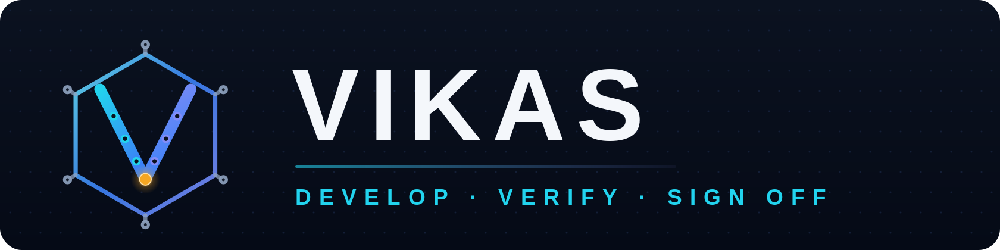

<p align="center">
  
</p>

<h1 align="center">VIKAS</h1>

<p align="center">
  <strong>विकास — the open, Linux-native, offline-first RTL platform.</strong><br/>
  Develop · Verify · Sign Off — from first waveform to tapeout-risk score, in one binary.
</p>

<p align="center">
  <a href="#-what-vikas-is">What is VIKAS</a> ·
  <a href="#-quick-start">Quick Start</a> ·
  <a href="TROUBLESHOOTING.md">Troubleshooting</a> ·
  <a href="#-the-17-breakthroughs">17 Breakthroughs</a> ·
  <a href="#-the-6-native-waveform-formats">6 Wave Formats</a> ·
  <a href="#-command-catalog-59-commands">59 Commands</a> ·
  <a href="#%EF%B8%8F-architecture">Architecture</a> ·
  <a href="#-verification-evidence">Verification</a>
</p>

<p align="center">
  <a href="https://github.com/ginnela-sairam/Vikas/actions/workflows/ci.yml"></a>
  
  
  
</p>

---

## विकास — the name is the mission

**Vikāsa (विकास)** is Sanskrit for *development, blossoming, unfolding* — the moment
something held inside begins to express its full form. That is exactly what an RTL
platform does: a design exists as an idea, and through simulation, debugging and
verification it *develops* into silicon-ready truth.

VIKAS is built around that single idea. Every capability exists to make the path from
**idea → verified design → signoff** shorter, more transparent and more honest:

* **Open** — the whole platform is open source. No licence servers, no seat counts,
  no encrypted formats. Read the kernel, extend it, ship it.
* **Native** — 100% Rust core with a C++20 mixed-signal twin. One static binary,
  millisecond startup, Linux syscalls used the way they were meant to be used.
* **Offline** — everything works with zero network access. On a laptop, on a lab
  bench, on an air-gapped cluster, on a plane: identical behavior.
* **AI-native** — an MCP JSON-RPC server and machine-readable `--json` outputs make
  VIKAS a first-class tool for AI coding agents, not a human-only island.
* **Self-maintaining** — the binary knows the commit it was built from, warns the
  moment it goes stale, and heals itself with one command (`vikas update`); if
  anything looks wrong, `vikas doctor` diagnoses the environment in seconds.
* **Yours** — every file you produce (dumps, graphs, reports) is an open, documented
  format you can parse with ten lines of any language.

> VIKAS does not ask you to change the way you think. You write SystemVerilog and
> Verilog, you read waveforms, you hunt bugs. VIKAS makes every one of those steps
> faster, deeper and fully yours.

## 🔬 What VIKAS is

VIKAS is a complete RTL development environment in a single `vikas` binary:

| Layer | What it does |
|---|---|
| **XEZIM simulation kernel** | Event-driven SystemVerilog/Verilog interpreter with IEEE-style delta + NBA scheduling, multi-file projects, industry filelists, `include` search paths, parameters, unpacked memory arrays, expression port connections — 100% Rust, zero Python in the core |
| **Open-KDB design-graph intelligence** | A live CSR (cause–signal–result) graph of your design: driver cones, fan-in tracing, Tarjan SCC loop detection, CDC analysis, FSM extraction, counterfactual solving, SVA synthesis |
| **Silicon-physics twin** | Live E = ½CV² energy tracks, switching power from real toggle counts, sub-threshold 0.12 V and cryo 77 K corner engines, glitch-hazard detection, P-Bit stochastic computing, HDC fingerprints, a C++20 RK4 closed-loop SAR-ADC co-simulator |
| **Native wave engine** | Six innovative native waveform formats (plus full VCD interop), a temporal query engine, FFT signal-quality analytics, bus protocol decoding, RV32I disassembly, parallel diff |
| **Three interfaces** | An offline single-file **HTML5 Canvas GUI**, a keyboard-driven **TUI**, a 59-command **CLI** — and a built-in vim-style editor |
| **AI & CI integration** | MCP server for AI agents, WCP hot-reload socket server, JSON machine reports, exit-code gates for regression pipelines |

It speaks **59 commands** today, organized around one flow:
**develop** (`run`, `quickrun`, `watch`, `edit`) → **verify** (`latch`, `kdb`, `cdc`,
`loops`, `mutant`, `find`, `why`, `doctor`) → **sign off** (`signoff`, `ci`, `power`).

## 🚀 Quick start

```bash
# 0. get the source
git clone https://github.com/ginnela-sairam/Vikas && cd Vikas

# 1. build (one command: build + test + smoke-check) — the `bash` form works
#    anywhere, any time, no permission bits required:
bash build_linux.sh
#    (`./build_linux.sh` also works on a fresh clone — the CI exec-bits
#     guard guarantees the bits, so friends never see 'Permission denied')

# 2. install to ~/.local/bin (optional, sudo-less by design)
bash install_linux.sh

# 3. first simulation — compile RTL, auto-dump waveform, build Open-KDB,
#    run physics telemetry and latch analysis, all in one command:
vikas run examples/demo_riscv_alu_hazard.sv

# 4. open the waveform — pops up in your default browser automatically
#    (new window; WSL-aware). All data embedded — works fully offline.
vikas gui                             # browser window pops open
vikas gui --no-open                   # ... or just write the HTML file
vikas tui .vikas/vikas_wave.vwf       # or the terminal UI

# 5. ask the design a question
vikas why alu_result examples/demo_riscv_alu_hazard.sv
```

### 🔄 Everyday updates — never a stale binary (breakthrough #25)

```bash
# ONE command = git pull + rebuild + reinstall:
vikas update

# want to see what it would do first?
vikas update --check

# environment feels off? binary path, freshness, PATH, WSL bridge report:
vikas doctor
```

Why this exists: a real friend pulled new code and ran the **old compiled
binary** for hours — the GUI never opened and *nothing told him why*.
VIKAS now fixes that class of failure permanently:

* **every build stamps its commit hash into the binary** (`vikas version` → `build: v1.0.0+<hash> · <date> · <path>`)
* **any command instantly warns** `BINARY IS STALE: built from X, checkout is at Y — fix: vikas update` when the checkout has moved on
* **the GUI file itself** carries the build stamp and states it is an offline file — not a localhost page
* `vikas update` refuses to touch a dirty tree (stash advice printed) and pulls strictly fast-forward

### A 5-minute tour

```bash
# zero-touch automation: auto-generate a testbench, then simulate
vikas quickrun examples/demo_fsm_uart.sv

# BREAKTHROUGH #13 — 3-layer inferred-latch detection (exit 2 = latches found)
vikas latch examples/demo_latch_trap.sv

# multi-file projects: industry filelists with +incdir+, +define+, nested -f
vikas run examples/multifile_proj/project.f        # -> result=200 exact
vikas run examples/nova_soc/nova.f                 # 26-file SoC: NOVA-PASS 9/9

# BREAKTHROUGH #14 — RTL mutation testing: is your testbench any good?
vikas mutant examples/nova_soc/nova.f --min-score 70 --json

# BREAKTHROUGH #15 — switching power from REAL toggle counts in the dump
vikas power .vikas/vikas_wave.vwf --vdd 0.8

# BREAKTHROUGH #16 — one-command tapeout-risk signoff (exit 0 = READY)
vikas signoff examples/nova_soc/nova.f --mutant

# silicon physics at the edge: 0.12 V sub-threshold, 77 K cryo
vikas physics examples/demo_sar_adc.sv --vdd 0.12 --temp-k 77

# mixed-signal: closed-loop C++20 RK4 twin of a SAR ADC
vikas cosim 12

# live re-simulation on every save (inotify)
vikas watch examples/demo_fsm_uart.sv
```

## ⚡ The 17 breakthroughs

Capabilities that make VIKAS *VIKAS* — each one is a first-class CLI command with
JSON output and CI exit codes.

| # | Breakthrough | Command |
|---|---|---|
| 1 | **Counterfactual "why is this value wrong" solver** — finds the minimal set of blocking inputs that would change any signal | `vikas why` |
| 2 | **Live silicon physics during RTL simulation** — E = ½CV² energy tracks written straight into the waveform dump | `vikas energy` |
| 3 | **Sub-threshold & cryo-CMOS corner engine** — 0.12 V near-threshold and 77 K cryo verdicts with FO4 depth analysis | `vikas physics --vdd 0.12 --temp-k 77` |
| 4 | **64-bit causality taint-dye propagation** — paint an origin and watch the dye flow forward through every dependent signal | `vikas taint` |
| 5 | **P-Bit / stochastic / entropy engine** — Glauber-dynamics p-bits, entropy analytics and 10,000-bit HDC hypervector fingerprints | `vikas pbit`, `vikas hdc` |
| 6 | **Closed-loop C++20 RK4 mixed-signal twin** — a real numerical co-simulator; SAR-ADC monotonicity is verified in CI | `vikas cosim` |
| 7 | **E-Graph equality-saturation micro-architecture repair** — rewrites redundant logic cones and emits an SV patch | `vikas egraph` |
| 8 | **fork() copy-on-write silicon time-forking** — snapshot the whole simulation and fork N futures | `vikas fork` |
| 9 | **Sub-cycle glitch hazard detection** — VIKAS_CAUSALITY tracks expose hazards between clock edges | `vikas physics` |
| 10 | **/dev/shm zero-disk-wear arena + lock-free SPSC ring** — waveforms stream through shared memory, not your SSD | `vikas shm` |
| 11 | **Bit-parallel temporal query engine** — search every signal's entire history for boolean conditions at machine-word speed | `vikas find` |
| 12 | **WCP \0-framed live-waveform server + native MCP server** — hot-reload into Surfer; drive VIKAS from any AI agent | `vikas wcp`, `vikas mcp` |
| 13 | **3-layer inferred-latch detection** — L1 static AST analysis + L2 live latch-hold waveform telemetry (`VIKAS_CAUSALITY_latch_hold_*`) + L3 copy-paste SystemVerilog patches; exit 2 in CI | `vikas latch` |
| 14 | **RTL mutation testing** — op-swaps (`+↔−`, `==↔!=`, `<<↔>>`, `&&↔||`), const-zeroing and off-by-one injected into every DUT module (the testbench is never mutated), each mutant re-simulated against golden; survivors come back as a precise testbench-gap report | `vikas mutant` |
| 15 | **Waveform-driven switching power** — P = Σ ½CV²·f_tr computed from *real* toggle counts in the dump: hotspot ranking, clock-tree share, clock-gating verdict, fJ/cycle budgets | `vikas power` |
| 16 | **One-command tapeout-risk signoff** — latch audit + combinational loops + CDC + toggle coverage + liveness freeze + TB verdict (+ optional mutation score) composed into one weighted 0–100 scorecard; exit 0 READY / 1 AT RISK / 2 BLOCKED | `vikas signoff` |
| 25 | **Self-aware binary: never stale again** — every build stamps its git commit into the binary; every command warns the moment the checkout moves ahead of the binary (the #1 real-world friend failure: `git pull` without rebuild), `vikas update` pulls + rebuilds + reinstalls in one word, and `vikas doctor` reports binary freshness, PATH, WSL browser bridge, git/cargo — the environment report a stuck friend actually needs | `vikas update`, `vikas doctor` |

## 🌊 The 6 native waveform formats

Every dump VIKAS writes is a documented, open, binary-native format — plus full VCD
interoperability. All six round-trip losslessly (verified by unit tests) and convert
freely with `vikas convert`.

| ext | Name | Superpower |
|---|---|---|
| `.vwf` | VIKAS Waveform File | binary indexed change table + CRC32 integrity checking |
| `.vwt` | VIKAS Temporal | time-sectioned regions for partial reads of huge captures |
| `.vwe` | VIKAS Encoded | delta-time + value-RLE compression for archival |
| `.vwp` | VIKAS Physics | analog f64 lanes carrying physics telemetry next to digital signals |
| `.vwi` | VIKAS Indexed | per-signal seek index — O(1) random access to any signal's history |
| `.vwm` | VIKAS Memorymap | 32-byte aligned records for zero-copy `mmap` readers |

```bash
vikas convert .vikas/vikas_wave.vwf out.vwt     # lossless, any -> any
vikas convert .vikas/vikas_wave.vwf out.vcd     # export for any third-party viewer
```

## 📂 Multi-file projects, 30 source types

Real RTL lives in dozens of files, include headers and manifests — VIKAS loads it all:

* **21 HDL source extensions**: `.sv .svh .svi .svp .svt .sva .svlib .vams`
  `.v .vh .vg .vi .vo .vlog .ver .vhd .vhdl .vho .uvm .mhdl .rtl .netlist .pkg`
* **9 filelist/manifest extensions**: `.f .flist .filelist .args .scr .q .cmd .files .list`
* Industry filelist semantics: `+incdir+dir` search paths, `+define+NAME=VALUE`,
  nested `-f other.f`, `#`/`//` comments
* `include resolution across search paths, file-scope parameter const-folding,
  UVM-aware loading (UVM imports are tolerated gracefully offline)

```bash
vikas run project.f                  # or several files at once:
vikas run rtl/alu.sv rtl/regfile.sv rtl/top.sv inc/common.vh
```

## 🖥️ Three interfaces, one binary

### HTML5 GUI — `vikas gui`
A complete offline waveform debugger as a **single self-contained HTML file** — no
server, no network, no install; open it in any browser on any machine:

* hover-hold ~0.2 s on any track → tooltip: signal name, live value + width, `t`,
  next-change Δt, category, navigation hints
* click = cursor (values in the margins) · shift-click = second cursor + Δt / frequency HUD
* wheel = zoom · drag = pan · `+`/`−` zoom · arrows pan/select · `F1` help · `Esc` close
* search box accepts `signal_name` *or* temporal boolean expressions: `valid && !ready`

### TUI — `vikas tui`
A keyboard-driven terminal UI with ASCII waveform lanes (`▔▔____▔▔`), `j`/`k` signal
navigation, `/` filtering, `q` quit — verified rendering in a real PTY. Falls back to a
friendly message (never a raw OS error) when no terminal is attached.

### CLI — 59 commands
The full catalog lives in `vikas help` — every command prints human output by default
and machine output with `--json` where it matters. Exit codes are CI-stable:
`0` clean · `2` latches/defects found · `3` quality gate below `--min-score`.

### Built-in editor — `vikas edit`
A vim-style editor (`h j k l i :w :q`) so a fresh Linux box with nothing installed is
already a complete RTL workbench.

## 📋 Command catalog (59 commands)

`vikas help` prints this catalog live from the binary. Every analysis command is
designed for both humans (default output) and pipelines (`--json` + stable exit codes).

**Simulation & automation — the develop loop**

| Command | What it does |
|---|---|
| `run <files\|manifest.f> [--top m] [--max-ns N] [--gui]` | simulate + auto-dump + Open-KDB + physics telemetry + latch alert |
| `quickrun <files>` | auto-generate testbench stimulus, then simulate |
| `watch <files>` | inotify live re-simulation on every save |
| `autogen-tb <rtl.sv>` | write an auto-testbench to `<rtl>_tb.sv` |
| `edit [file]` | built-in vim-style editor |

**Open-KDB design-graph debug**

| Command | What it does |
|---|---|
| `kdb <files> [--top]` | build the CSR graph → `.vikas/open_kdb.vikas.json` |
| `trace <sig> <files>` | active driver & fan-in cone tracer |
| `xtrace <sig> <files>` | clickable `vscode://` cross-probe links |
| `cdc <files>` | clock-domain crossings + synchronizer depth |
| `fsm <files>` | FSM state & transition extractor |
| `sva <files>` | auto-SVA assertion synthesizer |
| `loops <files>` | Tarjan SCC combinational-loop detector |
| `recommend <sig> <files>` | Jaccard smart-signal recommender |
| `why <sig> <files>` | counterfactual blocking-input solver (breakthrough 1) |
| `doctor <files>` | AI root-cause diagnostic bundle |
| `schematic <sig> <files>` | Graphviz DOT + Mermaid cone export |
| `coverage [dump]` | toggle coverage + dead-silicon list |

**Wave analysis**

| Command | What it does |
|---|---|
| `gui [dump]` / `tui [dump]` | the two interactive viewers (above) |
| `summary [dump]` | executive telemetry scorecard |
| `annotate <file.sv> --time t` | inline live-value RTL source annotator |
| `find "cond" [--dump d]` | bit-parallel temporal search |
| `expr "a && b"` | virtual-signal expression evaluator |
| `diff <a> <b>` | parallel earliest-divergence differ |
| `decode [dump]` | bus protocol auto-decoder: AXI/APB/SPI/I2C/UART |
| `disasm [dump]` | RV32I opcode disassembler |
| `spectrum [dump] --bus b` | FFT: SNR / SINAD / THD / SFDR / ENOB |
| `perf [dump]` | backpressure & stall utilization profiler |
| `radix <hex> q15\|fp16\|bf16\|fp8` | fixed-point & AI-float translator |
| `memdump [dump] --array a --time t` | 2-D memory hex inspector |
| `export-doc [dump]` | WaveDrom JSON + publication SVG |
| `export-tb [dump]` | waveform → standalone SV testbench |
| `anomaly [dump]` | deadlock / livelock freeze detector |
| `delta <t1> <t2>` | Δt / frequency / latency calculator |
| `cycles <t> <period-ns>` | ns ↔ clock-cycle ruler |
| `convert <in> <out>` | lossless conversion: 6 native formats ↔ VCD |
| `formats` | native format reference |

**Silicon physics**

| Command | What it does |
|---|---|
| `physics <files> --vdd V --temp-k T` | live physics + sub-threshold / cryo verdicts |
| `energy <files> --vdd V` | E = ½CV² dynamic energy estimate |
| `sweep --vdd a,b,c --temp-k T` | multi-corner V/T sweep table |
| `pbit [dump]` | Glauber p-bit + entropy analytics |
| `cosim [bits]` | C++20 RK4 SAR ADC closed-loop twin |
| `egraph "a&&a"` | equality-saturation cone repair → SV patch |
| `hdc [dump]` | 10,000-bit hypervector fingerprint |
| `taint <src> <dst> <files>` | 64-bit causality dye propagation |

**Linux-native engine**

| Command | What it does |
|---|---|
| `topo` | CPU topology + auto-tune report |
| `fork [N]` | fork() CoW snapshot timing |
| `shm` | /dev/shm zero-disk-wear arena status |

**AI & integration**

| Command | What it does |
|---|---|
| `mcp [workdir]` | MCP JSON-RPC 2.0 server: signals / wave_slice / end_time |
| `wcp --addr host:port` | WCP \0-framed hot-reload waveform server |

**Project & CI**

| Command | What it does |
|---|---|
| `session` | print/validate `vikas.toml` session-as-code |
| `ci <files>` | regression gatekeeper: latch=0, loops=0 report |
| `gate-compare <rtl> <gate>` | RTL vs gate-level waveform co-verify |

**Quality gates (breakthroughs 13–16)**

| Command | What it does |
|---|---|
| `latch <files> [--json]` | 3-layer inferred-latch detection, exit 2 on hits |
| `mutant <files> [--min-score S] [--json]` | RTL mutation testing → testbench-gap report, exit 3 under score |
| `power [dump] [--vdd V] [--json]` | switching power from real toggles: hotspots, clock-tree share |
| `signoff <files> [--mutant] [--json]` | one-command weighted tapeout-risk score, exit 0/1/2 |

## 📡 AI agents & tool integration

```bash
vikas mcp .            # MCP JSON-RPC 2.0 server: signals / wave_slice / end_time
vikas wcp --addr :4567 # WCP \0-framed hot-reload server (Surfer-compatible)
```

Any MCP-capable AI agent can list your signals, slice waveforms and ask temporal
questions. Every analysis command also emits `--json` for scripted pipelines.

## 🧪 Proof it works: NOVA-SoC

`examples/nova_soc/` is VIKAS's deep validation vehicle — **26 files, 5 hierarchy
levels, ~2,500 lines, 9 source-file types**:

a 16-op ISA CPU (decoder / regfile / ALU / PC), dual-master bus + arbiter,
128×16 RAM, UART TX (8N1), SPI master (mode-0 loopback), timer + IRQ, PWM, GPIO,
2-FF synchronizer (`.v`), watchdog (`.v`, Verilog-2001), tie cells (`.netlist`),
VHDL golden spec (`.vho`), UVM markers (`.uvm`), `.vh`/`.svh` headers, nested
filelists — driven by a UVM-style testbench running a 27-instruction program
(sum loop, branch, spin-wait on `spi_done`, memory-mapped IO) with **9 golden
checks**:

```bash
vikas run examples/nova_soc/nova.f                  # NOVA-PASS 9/9
vikas run examples/nova_soc/docs/manifest.files     # alternate manifest: same 9/9
vikas signoff examples/nova_soc/nova.f              # 90/100 SIGNOFF READY
vikas signoff examples/nova_soc/nova.f --mutant     # 85/100 with the mutation gate in
```

ISA loop/branch/spin-wait ✓ · UART byte recovered through the serial line ✓ ·
SPI loopback ✓ · timer IRQ ✓ · watchdog no-bark ✓ · 2-FF synchronizer ✓ ·
PWM activity ✓ · tie-cells via bus status ✓ · dual-master debug reads ✓

The NOVA campaign is also how VIKAS hardens itself: together with the earlier
multi-file bring-up, two validation campaigns surfaced and fixed **26 kernel bugs**
— late-edge passes for parent-scope events, for-loop park continuation,
concatenation order, bound-slice ranges, port width-fit direction, UTF-8-safe
lexing, expression port connections, 32-bit `integer` semantics, runaway-loop
guards and more (see `qa_results/` for the full evidence trail).

## 🏗️ Architecture

```text
vikas-eda/
├── crates/
│   ├── vikas-sim/       XEZIM kernel: lexer, parser, elaborator, event VM
│   │                    (IEEE delta + NBA regions), `include + filelists + params,
│   │                    unpacked memory arrays, latch-inference analysis,
│   │                    expression port connections, mutation-testing engine
│   ├── vikas-kdb/       Open-KDB: CSR design graph, Tarjan SCC loop detection,
│   │                    latch L1 static extractor, CDC, FSM, counterfactual, SVA
│   ├── vikas-physics/   E = ½CV² energy, switching-activity power, sub-threshold
│   │                    0.12 V + cryo 77 K engines, glitch hazards, P-Bit/Glauber,
│   │                    HDC fingerprints, E-Graph repair + C++20 RK4 twin
│   ├── vikas-wave/      4-state values, VCD + 6 native formats, parallel diff,
│   │                    bit-parallel search, FFT ENOB, bus decode, RV32I disasm
│   ├── vikas-linux/     /dev/shm arena, fork() CoW snapshots, inotify watcher,
│   │                    cache-line-aligned SPSC ring buffer, CPU topology
│   ├── vikas-wcp/       WCP \0-framed socket server, .sucl generator, WaveDrom/SVG
│   │                    export, MCP JSON-RPC 2.0 server, HTML5 GUI generator
│   └── vikas-cli/       the `vikas` executable: 59 subcommands + TUI + editor
├── examples/            single-file demos + multifile_proj + nova_soc (26-file SoC)
├── docs/logo/           brand asset suite (SVG masters + PNG renders)
├── qa_results/          captured verification evidence for every claim in this file
└── build_linux.sh / install_linux.sh / test_matrix.sh
```

**Why Rust + one C++20 island?** The kernel, graph engine, wave engine and CLI are
pure Rust — memory-safe, dependency-light, one `cargo build` from source. The
mixed-signal twin is a single small C++20 module (RK4 integrator) built and linked
by the same `build_linux.sh`. Nothing else. No Python, no JVM, no interpreter
shims anywhere in the core.

## ✅ Verification evidence

Every claim in this README is backed by a captured artifact in `qa_results/`:

* **34/34 unit tests** — kernel semantics (incl. run-to-run determinism of
  main-clock auto-detection, kernel fix #24), latch L1, mutation engine,
  switching-power formula, E-graph, SAR twin, all 6 format round-trips
* **80/80 command-matrix checks** — `test_matrix.sh` executes every command
  path and captures its output, including the friendliness gates (GUI
  auto-open headless-safety, typo "did you mean" help)
* **Run-to-run determinism (kernel fix #24)** — the same `vikas run` reports
  byte-identical cycle counts on every invocation; before the fix, the
  main-clock auto-detect followed randomized HashMap order and multi-clock
  designs could flip between clocks. Evidence:
  `qa_results/determinism_kernel_fix24.txt` (20/20 identical runs)
* **NOVA-SoC 9/9 golden checks** on both manifests (`.f` and `.files`)
* **5 terminals in parallel: 41/41 checks** — fresh-install, NOVA deep-run,
  physics/cosim, all 6 wave formats + GUI/TUI, `env -i` hardiness — all green
  simultaneously
* **Clone-readiness 18/18** — three fresh directories as three different users
  (build-from-zero, prebuilt-binary, foreign-cwd minimal-env) each reproduce the
  same goldens: version banner, SAR 2999, latch exit 2, NOVA 9/9, signoff READY
* **GUI verified in real Chromium** at 455-signal scale — search narrows,
  boolean temporal queries match, hover tooltips pop, 5.1 M pixels painted;
  `vikas gui` auto-opens the OS default browser (new window, WSL-aware)
* **TUI verified in a real PTY** on the 455-signal NOVA dump — 5/5 checks

## 🧭 Philosophy

1. **Offline is a feature.** An engineer in a lab, on a plane or inside a
   firewalled cluster has the *same* tool as everyone else. VIKAS phones nobody.
2. **Every artifact is open.** Waveform formats, KDB graphs, reports — all
   documented binary/JSON that outlive the tool that wrote them.
3. **Linux-native, not Linux-tolerant.** `/dev/shm`, `fork()` CoW, `inotify`,
   lock-free rings, CPU topology — the platform uses the kernel's real gifts.
4. **The AI age is here.** Agents need MCP servers, JSON and stable exit codes
   more than they need another GUI. VIKAS ships all three.
5. **One binary, no ceremony.** `cargo build --release` (or `./build_linux.sh`)
   and you are in business on any Linux machine.

## 🎨 Brand assets

The logo suite lives in [`docs/logo/`](docs/logo/) — a bold symmetric **V** built
from two converging signal traces (digital cyan · analog indigo) with via-dots
riding each arm, meeting at a glowing amber **kernel node** — everything a design
is, inside a hexagonal silicon die:

| File | Use |
|---|---|
| `vikas_banner.png` / `.svg` | README hero, release announcements |
| `vikas_wordmark.png` / `.svg` | site headers, slides |
| `vikas_icon.png` + `vikas_icon_256.png` + `vikas_icon_128.png` (`.svg` master) | avatars, favicons, packaging |

Palette: deep navy `#0B1220` · cyan `#22D3EE` · blue `#3B82F6` · indigo `#818CF8` ·
kernel amber `#F5A623`. Type: Liberation Sans / Arial.

## 🗺️ Roadmap

* **v1.x** — deeper SV constructs (structs/packed unions, interfaces),
  gate-level SDF annotation, VPI-style C API
* **v2** — multi-kernel `mmap` wave streaming across processes, remote
  debug sessions over WCP, coverage closure analytics on the KDB graph

## 🪟 Maintaining this repo from Windows

Windows cannot store Linux executable bits, so a plain
`git add -A && git commit && git push` from Windows silently resets the three
shell scripts to non-executable — and a friend's next fresh clone dies with
`Permission denied` on their very first command. The CI **exec-bits guard** job
catches that within seconds of a push and prints the exact two-line self-heal.
The permanent 5-command recipe that prevents it entirely lives in
[`PUSH_WINDOWS.md`](PUSH_WINDOWS.md).

Contributions welcome — the codebase is deliberately small, readable Rust.
A good first project: extend `vikas decode` with another bus protocol, or teach
`vikas sva` a new assertion pattern.

## 📄 License

Open source, Apache-2.0. Build it, ship it, sell things on top of it —
विकास keeps developing.
